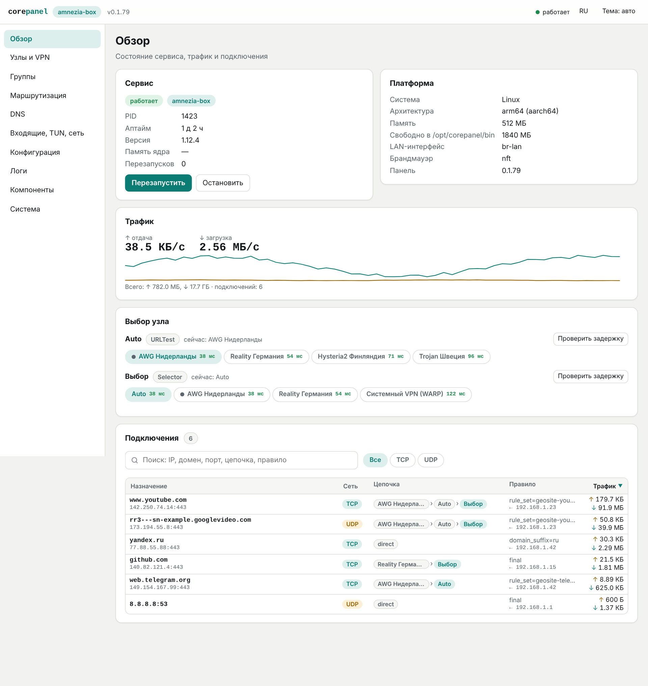
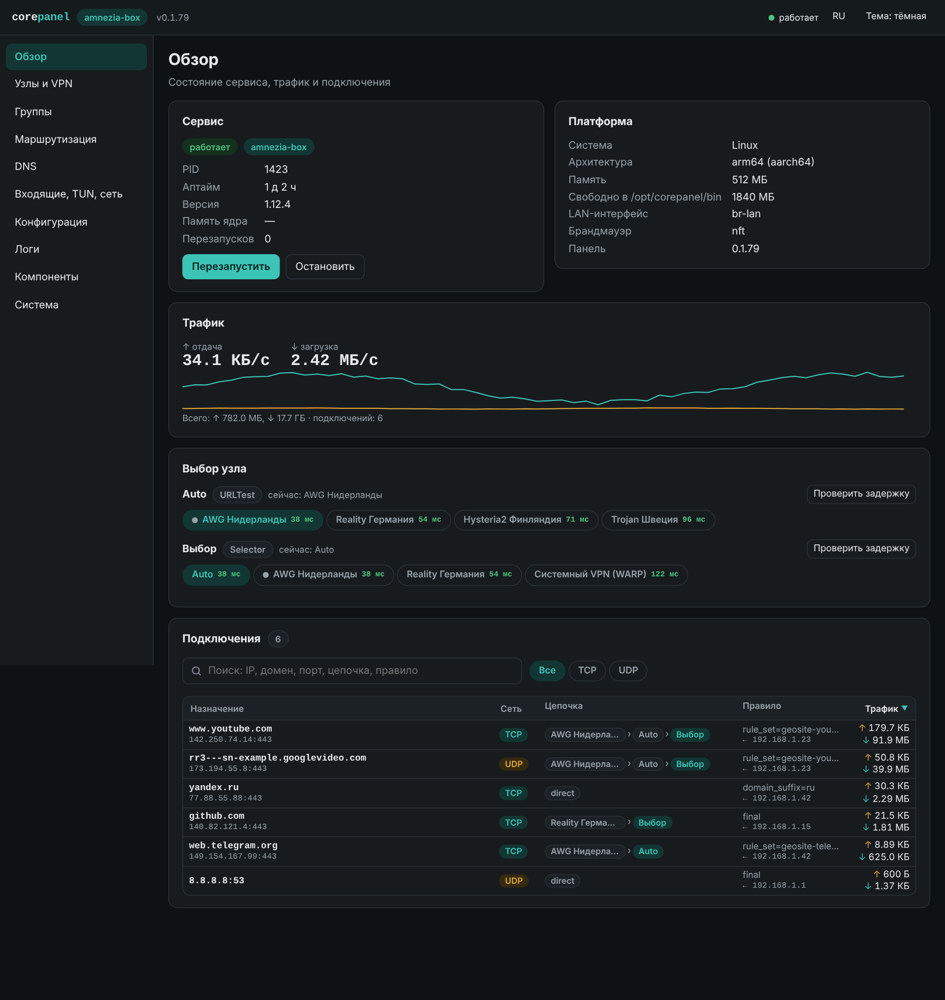
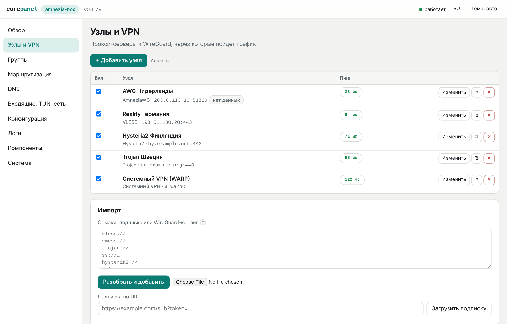
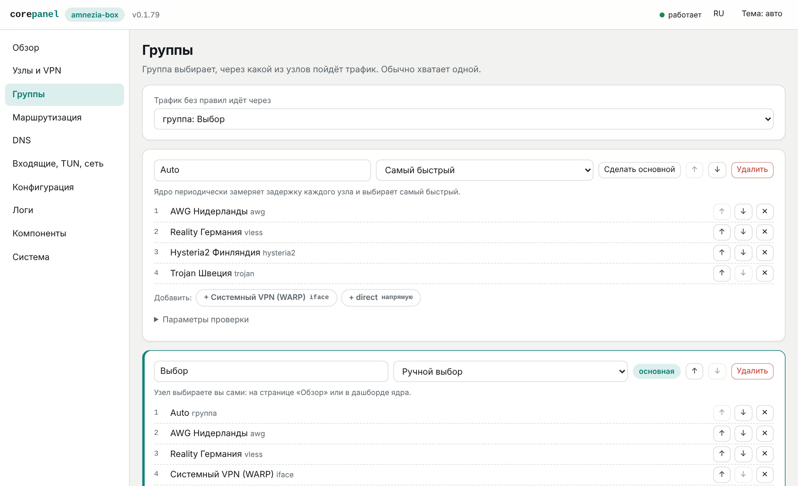
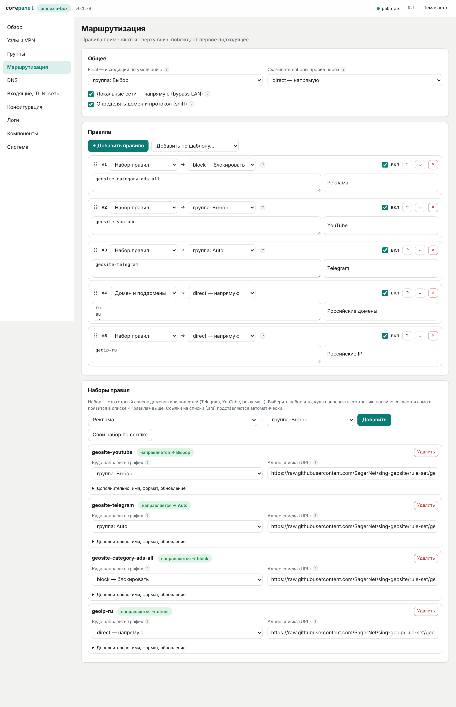
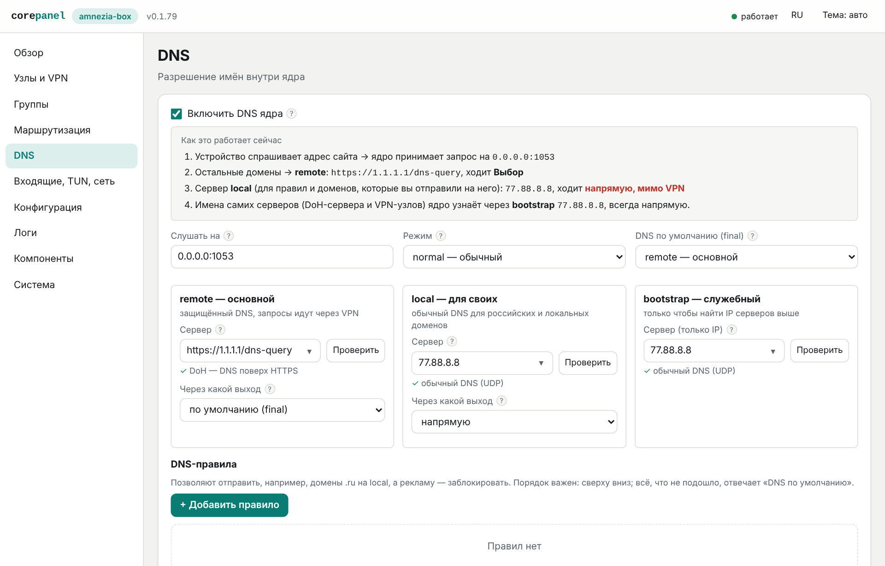
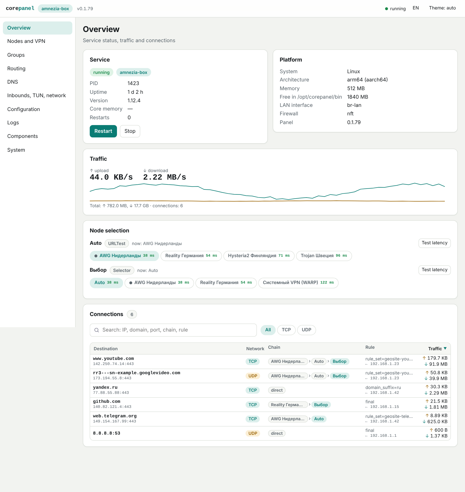
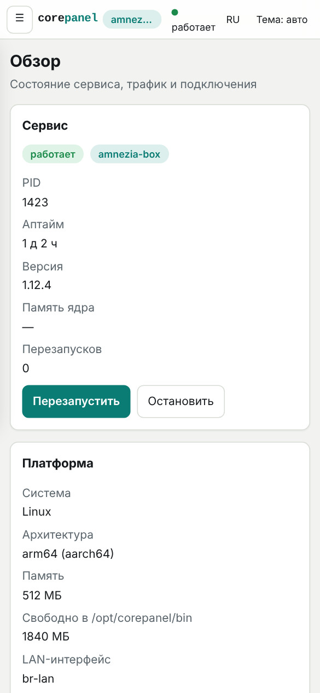

# corepanel — панель настройки awg-box для роутеров

Веб-интерфейс (Go + JS + CSS, один статический бинарник ~8 МБ, без зависимостей) для **OpenWrt**  (Entware)**.
Позволяет выбрать и установить ядро **[amnezia-box](https://github.com/phenomenonRT/amnezia-box)** (форк sing-box с AmneziaWG), добавить VPN/прокси-узлы, настроить маршрутизацию, DNS, TUN и прозрачный прокси — и запустить всё из браузера.


## Скриншоты

Данные на снимках демонстрационные (адреса из зарезервированных диапазонов, ключи ненастоящие).

| | |
|---|---|
| <br>**Обзор**: сервис, трафик, выбор узла, поиск по подключениям | <br>**Тёмная тема** |
| <br>**Узлы и VPN**: AmneziaWG, VLESS Reality, Hysteria2, системный VPN | <br>**Группы**: urltest и selector |
| <br>**Маршрутизация**: правила и наборы правил | <br>**DNS**: remote, local и bootstrap |
| <br>**English interface** | <br>**Телефон** |

## Возможности

- **Выбор ядра** и установка/обновление с GitHub (подбор архитектуры: mipsle, mips, arm, arm64, amd64…), несколько зеркал GitHub (пробуются по очереди, затем напрямую; кнопка «Проверить зеркала») и прокси для загрузки, свой бинарник.
- **Узлы и VPN:** VLESS (Reality, Vision), VMess, Trojan, Shadowsocks, Hysteria2, TUIC, WireGuard (в т.ч. системный интерфейс в sing-box), AmneziaWG (только на ядре amnezia-box; параметры Jc/Jmin/Jmax/S1–S4/H1–H4/I1–I5, импорт `.conf` с этими ключами), SOCKS/HTTP; импорт ссылок, подписок и `.conf` WireGuard; генерация ключей WireGuard/Reality и UUID; цепочки узлов, привязка к WAN.
- **Группы:** selector, urltest, fallback, loadbalance (в sing-box fallback/loadbalance заменяются urltest с предупреждением).
- **Маршрутизация:** правила по домену, IP, порту, протоколу, наборам правил (srs/mrs/…), geosite/geoip; порядок, пресеты, исходящий по умолчанию.
- **DNS:** DoH/DoT/UDP, FakeIP, DNS-правила, bootstrap, DNS через прокси.
- **Сеть:** входящие mixed/redirect/tproxy, TUN (stack, auto_route, auto_redirect, strict_route, блокировка IPv6 на время работы ядра), прозрачный прокси через **nft** или **iptables** для выбранных LAN-интерфейсов с include/exclude клиентов, перехват DNS; просмотр генерируемых скриптов.
- **Расширенные добавки:** любые поля ядра через глубокое слияние JSON (`override_singbox`).
- **Мониторинг:** статус, трафик, подключения, выбор узла и проверка задержки (через Clash API), живые логи.
- **Автовосстановление туннеля:** панель следит за журналом ядра и сама перезапускает его, если подряд накопились неудачные рукопожатия AmneziaWG (нужен уровень логов `debug`); число перезапусков подряд ограничено — защита от цикла, когда дело не в ядре. Включается галочкой в разделе «Компоненты».
- Безопасность: по умолчанию панель открывается **без пароля, но только из локальной сети** (запросы с публичных адресов отклоняются). Вход включается в разделе «Система»: пароль — тот же, что у root для SSH (проверяется по shadow; md5/sha256/sha512-crypt). HttpOnly/SameSite cookie, защита от CSRF, ограничение перебора. Забыли пароль — по SSH: `corepanel auth off`.

## Установка

Соберите (нужен Go ≥ 1.24) или возьмите готовые файлы из `dist/`:

```sh
scripts/build.sh 1.0.0        # создаёт dist/corepanel-linux-<arch>
```

Архитектуру роутера покажет `uname -m`; на Keenetic MIPS почти всегда `mipsle`, на OpenWrt смотрите `opkg print-architecture` (24.10 и старше) или `apk --print-arch` (25.x).

### Пакеты

| Система | Пакет | Установка |
|---|---|---|
| OpenWrt 24.10 и старше (opkg) | `corepanel_<версия>_<арх>_openwrt.ipk` | `opkg install ./corepanel_*.ipk` |
| OpenWrt 25.x (apk) | `corepanel_<версия>_<арх>_openwrt.apk` | `apk add --allow-untrusted ./corepanel_*.apk` |
| Keenetic (Entware) | `corepanel_<версия>_<арх>_entware.ipk` | `opkg install ./corepanel_*.ipk` |

Пакет `.apk` не подписан (поэтому `--allow-untrusted`) и собран в формате apk-tools v2, который читает и apk-tools 3 из OpenWrt 25. Внутри архитектура `noarch`: подходящий бинарник (`arm64`, `armv7`, `mipsle`…) выбираете вы по `apk --print-arch`. При сборке на GitHub пакет проверяется настоящим apk в Alpine, но на реальном роутере с OpenWrt 25 он пока не опробован.

### Каналы обновления: обычный и dev

Канал задаётся самой сборкой по номеру версии:

- `0.1.82` — обычный релиз. Такая панель обновляется только до обычных (не предварительных) релизов.
- `0.1.82-dev.1` — предварительный (dev) релиз, на GitHub он помечен как Pre-release. Такая панель обновляется только до dev-релизов, обычные ей не предлагаются.

Каналы не смешиваются: обычная панель никогда не получит dev-версию, а dev-панель — обычный релиз (перейти на другой канал можно только ручной установкой пакета). Канал виден в «Система → Обновление». В пакетах dev-версия записывается как `0.1.82~dev1` (opkg) и `0.1.82_pre1` (apk), поэтому считается старше обычной `0.1.82`. Dev-версии собирает отдельный workflow **«Сборка corepanel (dev)»** (Actions → Run workflow): номер можно не указывать — подставится следующий (`0.1.83-dev.1`, `…-dev.2` и т. д.), релиз публикуется как Pre-release, остаются три последних dev-релиза. Обычный workflow «Сборка corepanel» принимает только обычные версии и dev-релизы не трогает.

Скопируйте бинарник и `scripts/install.sh` на роутер и выполните:

```sh
sh install.sh /tmp/corepanel-linux-mipsle
# или, если выложили сборки на свой веб-сервер:
COREPANEL_BASE_URL=https://example.com/corepanel sh install.sh
```

Скрипт сам определит OpenWrt/Keenetic, положит бинарник (`/usr/bin` или `/opt/sbin`), создаст init-скрипт (procd / Entware) и запустит панель на порту **8088**. Логин `admin`, пароль печатается при первом запуске (`logread` / `/opt/var/log/corepanel.log`) или задаётся командой `corepanel passwd`.

### Требования к системе

| | OpenWrt |
|---|---|---|
| Пакеты | `kmod-tun`, для tproxy `kmod-nft-tproxy` | компонент «Пакеты OPKG», Entware |
| Каталог данных | `/etc/corepanel` | `/opt/etc/corepanel` |
| Ядра | `/etc/corepanel/bin` или `/opt` (USB) | `/opt/sbin` |
| Фаервол | nft (iptables — если нет nft) | iptables; nft — если есть |

Ядро занимает 30–50 МБ, amnezia-box (сжатая сборка, качается как готовый бинарник) — около 15 МБ; он есть только на GitHub, из пакетов системы не ставится. Скачанный файл кладётся в каталог установки как `<ядро>.new`, после проверки запуска переименовывается; при нехватке места он удаляется. При установке с GitHub архив не пишется на диск — он распаковывается прямо из потока, поэтому нужно место только под сам бинарник; при обновлении, если две версии не помещаются, старая удаляется автоматически. На роутерах с малой флеш-памятью есть два выхода: подключить USB-накопитель и указать каталог в разделе «Компоненты», либо нажать **«Из пакетов системы»** — панель выполнит `opkg install` / `apk add` (пакет `sing-box`); сборки из репозиториев обычно компактнее релизов GitHub, но набор функций в них может быть урезан и пакета может не оказаться для вашей прошивки. На Keenetic TUN/TPROXY зависят от модели и прошивки — при отсутствии используйте режим **redirect**.

## Обновление панели

Раздел **«Система» → «Обновление»**: показывает установленную и последнюю версию из [GitHub Releases](https://github.com/phenomenonRT/panel_awg-box_sing-box/releases) и, если вышла новая, кнопку «Обновить». Панель скачивает бинарник `corepanel-linux-<арх>`, сверяет его с `SHA256SUMS.txt`, проверяет, что он запускается, подменяет себя и перезапускает процесс (exec). Ядро при этом **не останавливается**: оно продолжает работать, правила TUN/`auto_redirect` не пропадают, и трафик не уходит мимо туннеля. Новая панель подхватывает работающее ядро по файлу состояния `runtime/core.state`; вывод ядра идёт в файл во временном каталоге (`/tmp`, tmpfs), а не в канал. Если ядро передать не удалось, панель по-старому останавливает его и запускает заново. Это работает при обновлении *с* версии, где такая передача уже есть: при обновлении со старой версии ядро ещё перезапускается. Переключатель **«Автообновление»** выключен по умолчанию: если включить, панель сама проверяет релизы раз в несколько часов и ставит новую версию. Зеркало и прокси берутся из настроек раздела «Компоненты».

## Команды

```
corepanel [run] [-listen host:port]
corepanel auth off
corepanel version
```

Переменные: `COREPANEL_DIR`, `COREPANEL_BIN_DIR`, `COREPANEL_PLATFORM`.

## Устройство проекта

```
cmd/corepanel      точка входа
internal/model     единая модель настроек + валидация
internal/gen       генератор config.json (amnezia-box / sing-box)
internal/importer  разбор ссылок, подписок, WireGuard .conf
internal/installer загрузка и установка ядер
internal/supervisor запуск ядра, проверка конфига, перезапуск, логи
internal/firewall  nft/iptables для redirect и tproxy
internal/server    HTTP API (+ прокси к Clash API ядра)
web/static         интерфейс (ES-модули, CSS)
scripts            build.sh, install.sh
```

## Ограничения

- Панель не проверялась на реальных роутерах из среды разработки: логика запуска и фаервола покрыта тестами и генерацией скриптов, но первый запуск на вашей модели стоит проверить (`Конфигурация` → предпросмотр, `Сеть` → просмотр скриптов).
- Сведения в справочнике отражают актуальные релизы на момент написания; детали по версиям сверяйте с документацией ядер.

## Сборка на GitHub по кнопке

Вкладка **Actions → «Сборка corepanel» → Run workflow**: укажите версию обычного релиза (например `0.1.82`; предварительные собирает отдельный workflow «Сборка corepanel (dev)»), и GitHub соберёт бинарники под 8 архитектур и пакеты `.ipk` (OpenWrt и Entware) и `.apk` (OpenWrt 25.x), прогонит `go vet` и тесты. Файлы появятся в артефактах запуска и (если включена галочка) в разделе **Releases**, вместе с `SHA256SUMS.txt`.


## Языки интерфейса

Интерфейс двуязычный: русский (исходные тексты в коде) и английский. Язык переключается кнопкой в шапке и на экране входа, выбор хранится в браузере; по умолчанию берётся язык браузера. Перевод — словарь `web/static/i18n/<код>.json`, ключи — русские фрагменты строк; непереведённое остаётся на русском. Чтобы добавить язык, положите `i18n/<код>.json` и допишите его в список `LANGS` в `web/static/js/i18n.js`. Сверка словаря с кодом: `python3 scripts/i18n.py check en`.

## Зеркала GitHub

В «Компонентах» можно задать несколько зеркал вида `https://ghfast.top/` (по одному в строке). Установщик ядра, проверка версий, обновление панели и загрузка наборов правил пробуют их по очереди и в конце — GitHub напрямую. В конфиг ядра для наборов правил подставляется только первое зеркало. Зеркало — посторонний сервер: оно может подменить файл, в том числе `SHA256SUMS.txt`, полученный через него же.
